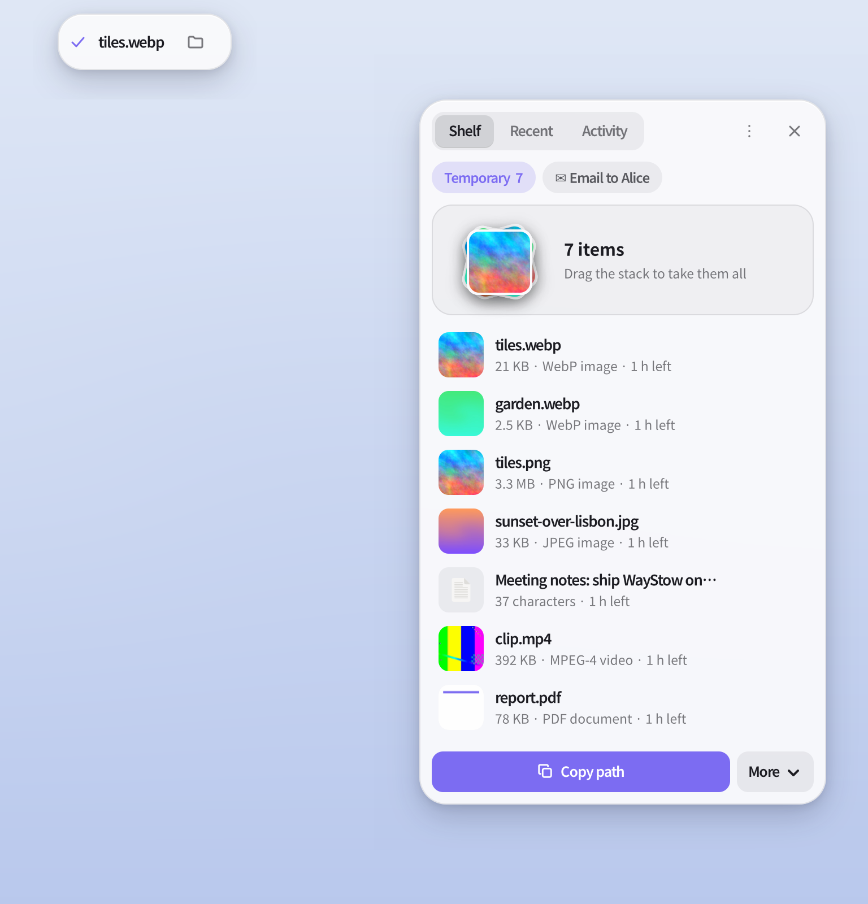
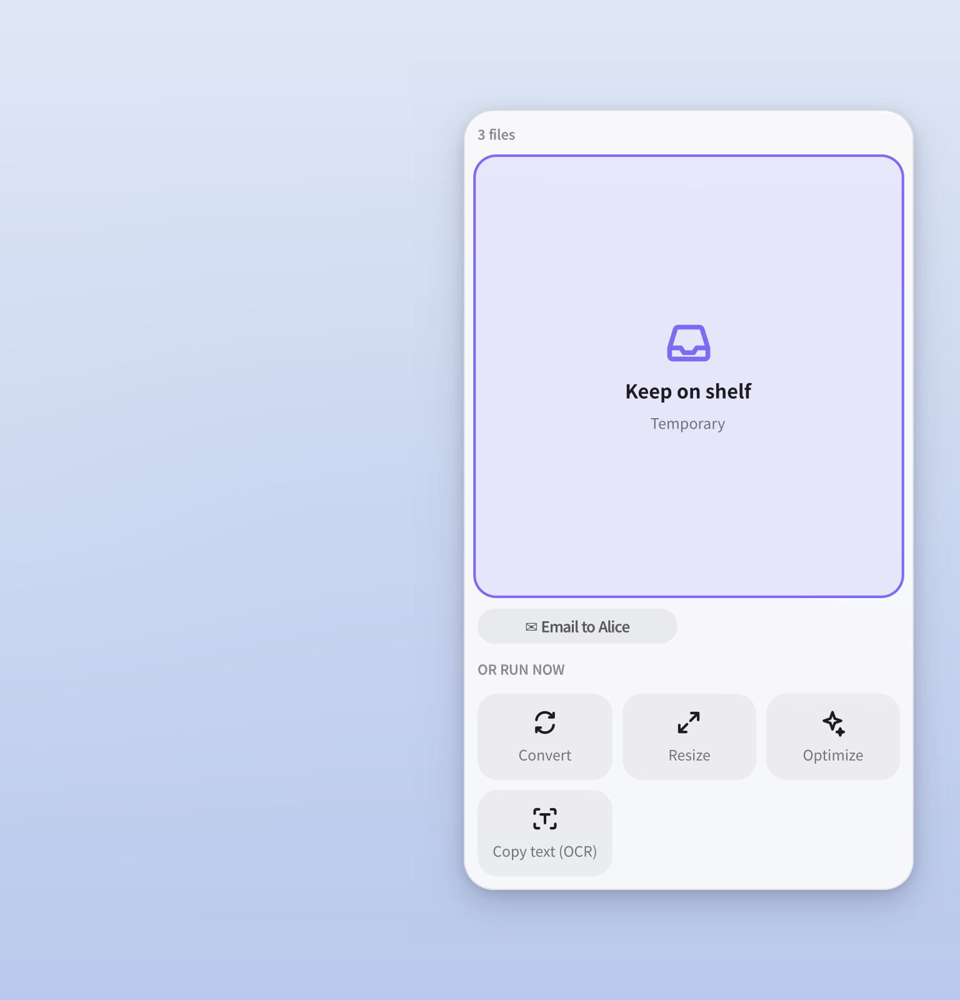

# WayStow

WayStow is a transient file shelf for Wayland. Drag anything to the edge of the screen and it's kept on a shelf, wherever it came from. Run actions on it (convert, resize, compress, OCR, merge…), then drag everything out together into an email, a chat or a folder.

<p align="center">
  <picture>
    <source media="(prefers-color-scheme: dark)" srcset="assets/shelf-dark.png">
    
  </picture>
</p>

- **Shelf.** Items are references: WayStow never moves or deletes your files. Items in *Temporary* expire after an hour unless pinned; named collections (e.g. "Email to Alice") keep theirs.
- **Actions.** Every action runs a mature tool (ImageMagick, ffmpeg, qpdf, Ghostscript, OCRmyPDF, Tesseract, exiftool, bsdtar, jq, qrencode). Results are written next to the input, never overwrite anything, and go to the Trash on undo. You can add your own in TOML.
- **Drop zones.** Dragging over the edge shows *Keep* plus the actions that fit what you're dragging, so you can convert without keeping.
- **Recent.** Finished downloads, new screenshots, files you copied or opened, and changes in folders you choose.
- **Island.** A pill for things in flight: job progress, downloads, a finished result, and new screenshots (annotate, OCR, copy, keep).
- **Any layer-shell compositor.** Tested end to end in a headless sway; niri offers every protocol it uses (`waystow doctor`). Hyprland, river, KDE and COSMIC should work. GNOME isn't supported (no layer-shell).

<p align="center">
  <picture>
    <source media="(prefers-color-scheme: dark)" srcset="assets/dropzones-dark.png">
    
  </picture>
</p>

## Install (Nix + home-manager)

```nix
# flake.nix
inputs.waystow.url = "github:yuxqiu/waystow";
inputs.waystow.inputs.nixpkgs.follows = "nixpkgs";

# home-manager configuration
imports = [ inputs.waystow.homeManagerModules.default ];
services.waystow = {
  enable = true;
  # package = inputs.waystow.packages.${pkgs.system}.waystow;  # without the bundled tools
  settings = { };                                               # see "Configuration"
};
```

This installs `waystow-full` (WayStow plus every tool its built-in actions use) and starts `waystow daemon` as a systemd user service with your graphical session.

Without home-manager: `nix profile install github:yuxqiu/waystow#waystow-full`, then run `waystow daemon` from your compositor's autostart (or `systemctl --user enable --now waystow`).

### Without Nix

Build with Rust (stable) and the development files of GTK ≥ 4.14 and gtk4-layer-shell:

```sh
cargo build --release -p waystow
install -Dm755 target/release/waystow ~/.local/bin/waystow
install -Dm644 dist/waystow.service ~/.config/systemd/user/waystow.service   # ExecStart expects waystow on PATH
```

Actions need their tools on `PATH`; `waystow doctor` lists what's missing.

### Bind a key

The edge catches drags by itself. For the keyboard, your compositor runs `waystow toggle`:

```kdl
// niri
binds { Mod+S { spawn "waystow" "toggle"; } }
```

```ini
# Hyprland
bind = SUPER, S, exec, waystow toggle
# Sway
bindsym Mod4+s exec waystow toggle
```

## Using it

- **Keep:** drag files, images from a browser, or text onto the right edge (configurable), and drop on *Keep*, a collection chip, or an action tile. `waystow add FILE…`, `waystow add --text "…"` and `waystow add --clipboard` (bind it to a key) work too.
- **Take:** drag the stack to take everything, or a row to take it (or the selection). Dropping your own row on a collection chip moves it there.
- **Act:** select rows (click, Ctrl-click, Shift-click) and use the action bar. Actions with settings (Resize %, Convert format, OCR language…) ask first.
- **Open the shelf:** click the small handle on the edge, or `waystow toggle`.

| Key (shelf open) | Action |
|---|---|
| ↑ ↓ (or j k) | Select |
| Space | Quick Look |
| ↵ | Open |
| Delete | Take off the shelf (the file is kept) |
| Ctrl+A | Select all |
| Tab | Shelf → Recent → Activity |
| Esc | Clear the selection, then close |

## Built-in actions

| Kind | Actions |
|---|---|
| Any | Copy path · Copy file · Show in folder · Open · Rename · Copy SHA-256 · Compress to ZIP / .tar.zst · Move to Trash |
| Image | Convert (WebP/PNG/JPG/AVIF) · Resize · Optimize · Copy text (OCR) · Copy image · Annotate (satty) · Remove metadata · Combine into PDF |
| Video | Compress · Make GIF · Extract audio · Convert to MP4 · Save first frame |
| Audio | Convert (mp3/opus/flac/m4a/wav) · Normalize loudness |
| PDF | Merge · Compress · Make searchable (OCR) · Split into pages · Extract pages · Pages to images |
| Archive | Extract here · List contents |
| Text | Copy contents · Save as file · Format JSON · QR code · Compare |
| Folder | Open terminal here |

```sh
waystow run --item 3                                   # actions for item 3
waystow run image.convert --item 3 --set format=avif --wait
waystow run pdf.merge --file a.pdf --file b.pdf --wait
waystow jobs; waystow undo 12
```

### Your own actions

Put TOML files in `$XDG_CONFIG_HOME/waystow/actions/` (or `services.waystow.actions`), then `waystow reload`. An action with a built-in id replaces it.

```toml
[[action]]
id = "upload.0x0"
title = "Upload"
icon = "ws-open-symbolic"            # bundled icons are ws-*-symbolic; theme icon names work too
mime = ["image/*", "application/pdf"]
requires = ["curl"]                   # hidden when missing
command = ["curl", "-sF", "file=@{in}", "https://0x0.st"]
stdout = "clipboard"                  # ignore | clipboard | shelf | file
```

Commands are argument lists; nothing goes through a shell. Placeholders: `{in}`, `{ins}` (all inputs, as separate arguments), `{out}`, `{dir}`, `{name}`, `{stem}`, `{ext}` and each param by name. Other keys: `arity` (`each`, `all`, `pair`), `min_inputs`, `exclude`, `params` (`int`, `choice`, `text`), `output` (a path template; the tool writes a hidden temporary file that is renamed into place only when the tool succeeds), `output_dir`, `progress` (`ffmpeg`, `percent`), `interactive`, `detach`, `success_codes`. The built-in pack in [`crates/waystow-core/assets/actions.toml`](crates/waystow-core/assets/actions.toml) shows them all.

## Configuration

`$XDG_CONFIG_HOME/waystow/config.toml`, or `services.waystow.settings`. Every key is optional; unknown keys are rejected. Apply changes with `waystow reload`.

```toml
[catcher]
edges = ["right"]          # any of left, right, top, bottom ([] = keybind only)
length = 0.3               # fraction of the edge that catches drags
thickness = 2              # px
handle = true              # a small handle on the first edge while the shelf has items

[ui]
theme = "system"           # system | dark | light
accent = ""                # "#rrggbb"; empty = the desktop's accent colour
width = 360
opacity = 0.94
client_shadow = true       # false when a compositor rule draws the shadow
reduced_motion = false
font = ""

[island]
enabled = true             # false = desktop notifications instead
position = "top"           # top | bottom
margin = 8
screenshots = true
downloads = true
toast_secs = 6

[shelf]
expiry = "1h"              # Temporary only: 30m, 1h, 2d or never; pinned items and named collections stay
max_payload_mib = 64       # dropped image bytes or text above this are refused, never cut

[recent]
days = 7
downloads = true
watch = ["~/Desktop", "~/Documents"]
screenshots = []           # default: $XDG_PICTURES_DIR/Screenshots
opened = true              # recently-used.xbel
copied = true
ignore = ["*.swp", "*.tmp", "*~", ".DS_Store"]

[jobs]
concurrency = 0            # 0 = half the CPUs
```

### Blur and shadow

GTK 4.24 and newer blur the panel by themselves where the compositor supports `ext-background-effect-v1`. Until then, ask the compositor. Compositors blur the whole layer surface, which would include WayStow's own shadow margin, so let the compositor draw the shadow too and set `ui.client_shadow = false` (lower `ui.opacity`, e.g. `0.8`, to see the blur). The layer namespaces are `waystow`, `waystow-island` and `waystow-quicklook`.

```kdl
// niri
layer-rule {
    match namespace="^waystow"
    geometry-corner-radius 24
    shadow { on; softness 28; spread 2; offset x=0 y=12; color "#00000073"; }
    background-effect { blur true; xray false; }
}
```

On Hyprland, add a `layerrule` that enables blur for the `waystow` namespaces (see the Hyprland wiki's layer rules page for the syntax of your version).

## Commands

```text
waystow daemon                 run the daemon (normally the systemd service)
waystow toggle|show|hide       the shelf panel
waystow add FILE… | --text T | --clipboard  [-c COLLECTION]
waystow list [-c C] [--json]   shelf items
waystow remove ID… | clear [-c C] | pin ID [--off]
waystow collection list|new|delete|move
waystow run [ACTION] --item ID… --file F… --set k=v [--wait]
waystow jobs | cancel JOB | undo JOB
waystow recent [--kind downloaded|screenshot|copied|opened|created|modified]
waystow status | reload | quit | doctor
```

## Development

```sh
nix develop                     # toolchain, GTK, sway, grim, wtype and every action tool
cargo test --workspace          # includes running all 27 built-in command actions on fixtures
scripts/e2e.sh                  # 30 end-to-end checks in an isolated headless sway
scripts/screenshots.sh          # re-render assets/
nix flake check                 # clippy (deny warnings), tests, rustfmt, package build
```

| Crate | Contents |
|---|---|
| `waystow-core` | Pure logic: config, model, action specs and templating, naming, state machines, IPC types |
| `waystow-store` | SQLite: collections, items, jobs, Recent |
| `waystow-jobs` | Job runner: process groups, progress, cancellation, safe renames |
| `waystow-wl` | Clipboard over data-control |
| `waystow` | CLI, daemon, GTK UI |
| `dev/dnd-probe` | Test client that drives drag-and-drop with a virtual pointer |

## License

Licensed under either of [Apache License, Version 2.0](LICENSE-APACHE) or [MIT license](LICENSE-MIT), at your option.
